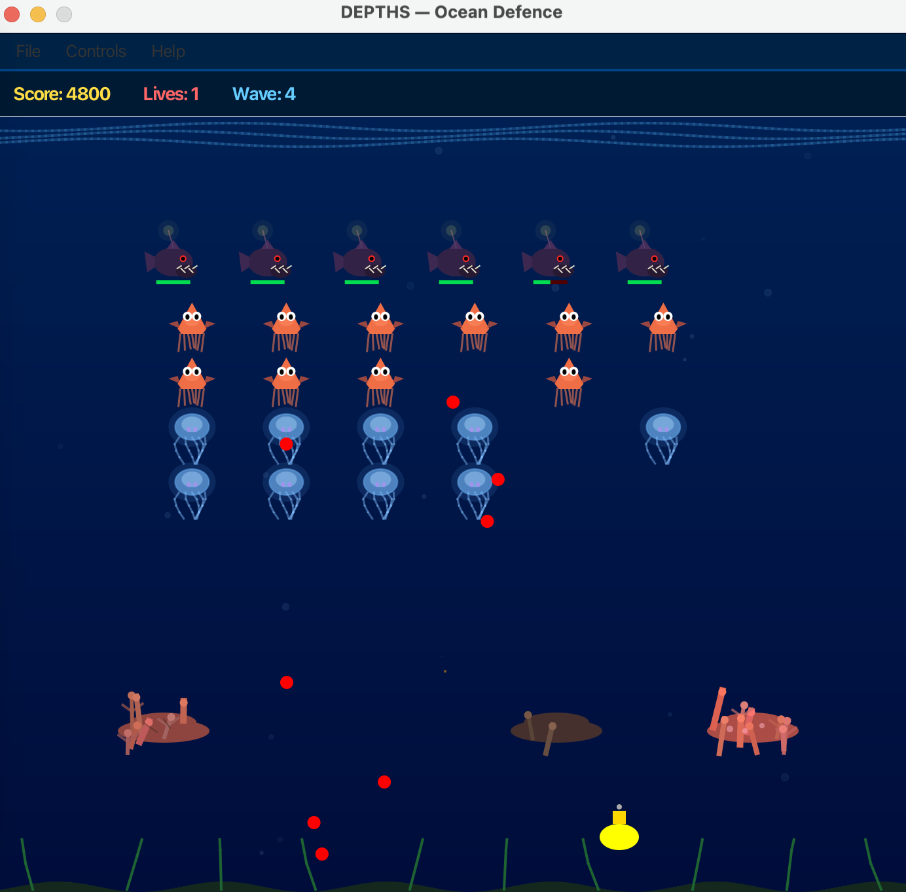
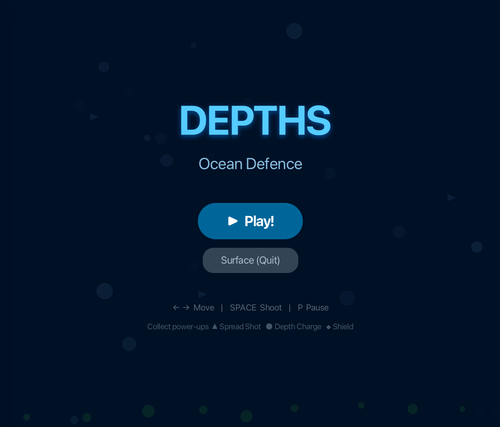
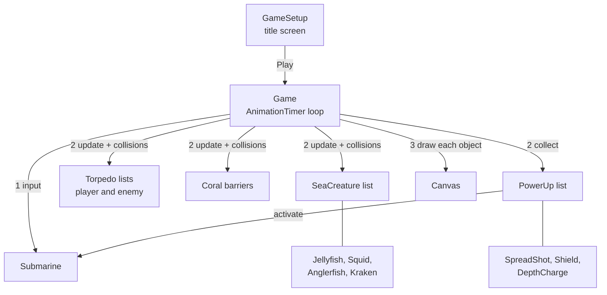

# DEPTHS — Ocean Defence

A fixed-screen arcade shooter written in Java and JavaFX. You steer a submarine along the sea floor and hold off descending waves of sea creatures. Every shape on screen is drawn in code from polygons, ovals and lines; the game ships no image or sound files.



## Problem and purpose

The goal was to design and build a complete game from scratch on a small class structure: a real game loop, input handling, collision detection, a score, and enemies that differ in behaviour without the loop needing to know which is which. It was also an exercise in two people planning the classes before writing them.

## Project status

**Academic coursework, complete.** A two-person project for *Programming Practice and Applications* (4CCSAPPA) at King's College London, submitted April 2026. It is a finished small game, not a maintained product.

## Screenshots

| Title screen | Gameplay |
|---|---|
|  |  |

Both are screenshots of the running game.

## Main features

- **Four enemy types** behind one abstract class: jellyfish (1 HP, 10 points), squid (1 HP, 20), anglerfish (2 HP, 30, fires more often) and a kraken boss every fifth wave (100 points, hit points grow with the wave) — [`SeaCreature.java`](src/SeaCreature.java).
- **Formation movement.** Enemies march sideways, reverse and step down when any of them reaches an edge. The kraken overrides this and moves on its own.
- **Destructible coral barriers** that block shots from both sides and visibly degrade over 12 hits — [`Coral.java`](src/Coral.java).
- **Three power-ups** with a 15 % drop chance: spread shot (three torpedoes for 10 seconds), shield (absorbs one hit) and depth charge (damages every enemy on screen) — [`PowerUp.java`](src/PowerUp.java).
- **Combo scoring.** Kills within 1.5 seconds of each other raise a multiplier up to ×5.
- **Escalating waves.** Each wave is faster and, over time, wider; the background darkens as the wave number rises.
- **Animated title screen** built with JavaFX transitions, plus a menu bar with restart, pause, how-to-play and about — [`GameSetup.java`](src/GameSetup.java).
- **Particle bursts** on hits and kills, drawn on the same canvas.

## Controls

| Input | Action |
|---|---|
| ← / → or A / D | Move |
| Space or mouse button | Fire |
| P | Pause / resume |
| R | Restart after game over |

## Technology stack

| Technology | Role |
|---|---|
| Java 21 | Game logic. Seven source files in the default package, as BlueJ expects. |
| JavaFX 23 | `AnimationTimer` for the loop, `Canvas`/`GraphicsContext` for drawing, the animation API for the title screen, controls for the menu bar and HUD. |
| Bash | Scripts to compile, run and check without an IDE. |
| GitHub Actions | Compiles the sources and runs the headless rule checks. |

## Architecture



Each frame the loop processes input, updates every object, resolves collisions and redraws. Each game object owns its own `draw(GraphicsContext)`.

## Quick start

Requirements: a JDK (21 tested) and JavaFX (23 tested).

If your JDK does not bundle JavaFX, point `JAVAFX_LIB` at a folder containing the `javafx-*.jar` files: the `lib` folder of an [OpenJFX SDK](https://openjfx.io), or `Contents/Java` inside a BlueJ installation.

```bash
export JAVAFX_LIB=/path/to/javafx-sdk/lib
```

```bash
scripts/run.sh
```

To use BlueJ instead, open the `src` folder as a non-BlueJ project, right-click `GameSetup` and choose *Run JavaFX Application*.

## Example workflow

1. Start the game and press **Play!**.
2. Wave 1 arrives as a grid: anglerfish on the top row, squid below, jellyfish at the bottom. Shoot upward through the gaps between your coral barriers.
3. Chain kills to build the combo multiplier. A falling green triangle, cyan diamond or red circle is a power-up; touch it to collect it.
4. Clear the grid to start the next, faster wave. Wave 5 adds the kraken.
5. The game ends when three lives are gone, either to enemy shots or to enemies reaching the sea floor. Press **R** to dive again.

## Engineering decisions

| Decision | Why | Trade-off |
|---|---|---|
| Abstract `SeaCreature` with `draw()` and `getPoints()` | The loop holds one `ArrayList<SeaCreature>` and never branches on enemy type. Adding an enemy means one new subclass. | Subclasses share a file with the base class to keep to the brief's file count. |
| Static factory methods (`createJellyfish`, …) | `Game` spawns enemies without naming the concrete classes. | A little indirection for four types. |
| Depth charge as a flag on `Submarine` | `PowerUp.activate(Submarine)` stays the single interface for all power-ups; the loop, which owns the enemy list, performs the detonation. | The effect is split across two classes. |
| One `Torpedo` class with a `friendly` flag | Player and enemy shots share movement and collision code. | Direction and colour are decided by a boolean, not by type. |
| Coral geometry from a position-seeded `Random` | Barriers look hand-drawn but identical every wave, with no stored asset. | Shape cannot be art-directed. |
| Frame-counted timers | Simple and deterministic at 60 fps. | Game speed follows the display's refresh rate. |

## Testing and evaluation

```bash
scripts/check.sh
```

Compiles the sources and runs [`test/GameLogicCheck.java`](test/GameLogicCheck.java) without opening a window. It checks enemy points and hit points (including the wave-5 kraken's 33), that the boss ignores formation movement, torpedo speed and contact detection, the coral's 12-hit lifetime, the submarine's one-second invincibility window, and that each power-up applies its own effect.

Not covered: the game loop itself (`Game.update`, `checkCollisions`), scoring and combo timing, wave progression and all drawing. Those were tested by playing.

## Limitations and roadmap

**Known issues**

- At high wave numbers the edge-reversal check can fire twice in one frame, which shows as a brief stutter in the formation.
- Spread-shot torpedoes start at the same height, so two can hit one enemy at close range.
- The high score lives in memory and is lost when the window closes.
- No sound.

**Possible next steps**

- Persist the high score and show a short leaderboard.
- Clamp formation speed; offset spread-shot origins.
- Difficulty selection and time-based (not frame-based) movement.
- Sound effects through JavaFX `AudioClip`.

## Authorship and acknowledgements

Built jointly by **Fakhriyya Vazirova** and **Waice Lim**; both are credited as authors of every class.

The game-loop structure follows the *Asteroids* example supplied with the module (Jeffery Raphael). The game design is inspired by *Space Invaders*. No starter code, sprites or third-party assets are included.

No licence has been chosen for this repository. Changes made while preparing it are listed in [docs/repository-cleanup.md](docs/repository-cleanup.md).
